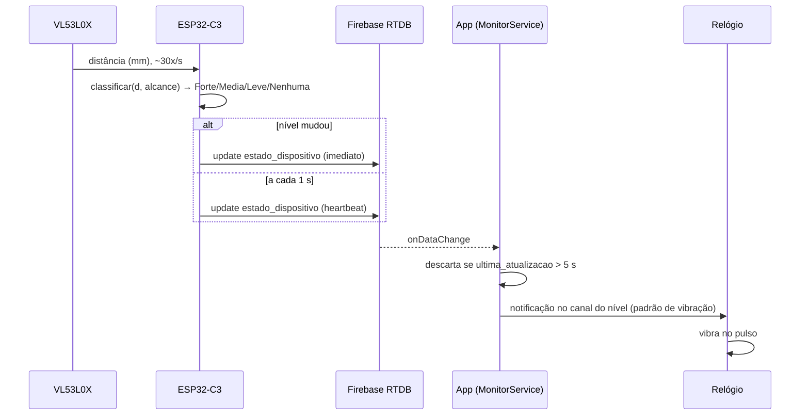

# Arquitetura

## Componentes

| Componente | Tecnologia | Responsabilidade |
|---|---|---|
| Óculos | ESP32-C3 Super Mini, VL53L0X, C++/Arduino | Medir, classificar o risco e publicar o estado |
| Banco | Firebase Realtime Database + Auth anônima | Canal em tempo real entre óculos, app e web |
| App Android | Kotlin, Material 3, Foreground Service | Alertar o usuário (notificação → relógio vibra) e configurar o alcance |
| Relógio | Galaxy Watch / Wear OS (espelho de notificações) | Vibrar no pulso |
| Painel web | HTML/CSS/JS + Firebase JS SDK 8 | Acompanhar ao vivo e configurar (familiares, demonstração) |

## Fluxo de um alerta



## Contrato de dados (Realtime Database)

```text
estado_dispositivo/                 ← escrito pelo óculos
  ultima_distancia     number   metros; -1 = sem obstáculo
  vibracao_atual       string   "Nenhuma" | "Leve" | "Media" | "Forte"
  alcance_maximo       number   alcance em uso pelo óculos (eco)
  conectado            boolean  sempre true (use ultima_atualizacao para saber se está online)
  ultima_atualizacao   number   ms, hora do SERVIDOR ({".sv":"timestamp"})

configuracoes/usuario_id/           ← escrito pelo app/web, lido pelo óculos a cada 2 s
  alcance_maximo       number   0,50 a 2,00
  timestamp            number   ms (servidor)
```

Regras de acesso e validação: [database.rules.json](../database.rules.json).

## Decisões técnicas

- **Firebase em vez de Bluetooth direto**: o óculos funciona com qualquer celular/navegador e permite o painel web; custo: depende de internet (ver limitações).
- **Classificação no firmware**: o nível é calculado perto do sensor; app e web só exibem o que o óculos decidiu, então não há divergência.
- **Envio por mudança + heartbeat**: reduz a latência do alerta sem enviar 30 requisições/s.
- **Hora do servidor** para detectar offline: não depende do relógio do celular nem do ESP32 (que não tem RTC).
- **Notificações em vez de app de relógio**: qualquer smartwatch que espelhe notificações funciona, sem desenvolver app para Wear OS/Tizen.
- **Foreground Service**: o Android encerra listeners de apps em segundo plano; o serviço mantém os alertas com a tela desligada.

## Limitações conhecidas (trabalhos futuros)

- **Depende de internet** nos dois lados (óculos e celular). Futuro: BLE direto óculos → pulseira.
- Latência típica de 300 ms a 1 s (rede + Firebase + espelhamento do relógio).
- O relógio pode usar o próprio padrão de vibração em vez do padrão do canal (depende do fabricante).
- Um único usuário (`usuario_id` fixo). Futuro: um nó por dispositivo/usuário.
- O VL53L0X sofre com luz solar intensa e superfícies muito escuras/transparentes; detecta só o que está à frente (cone de ~25°).
